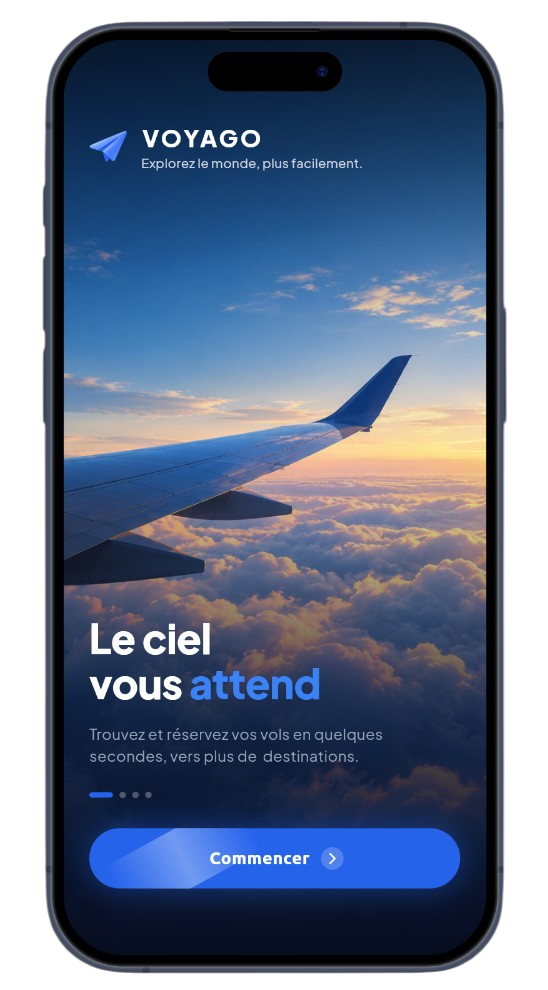
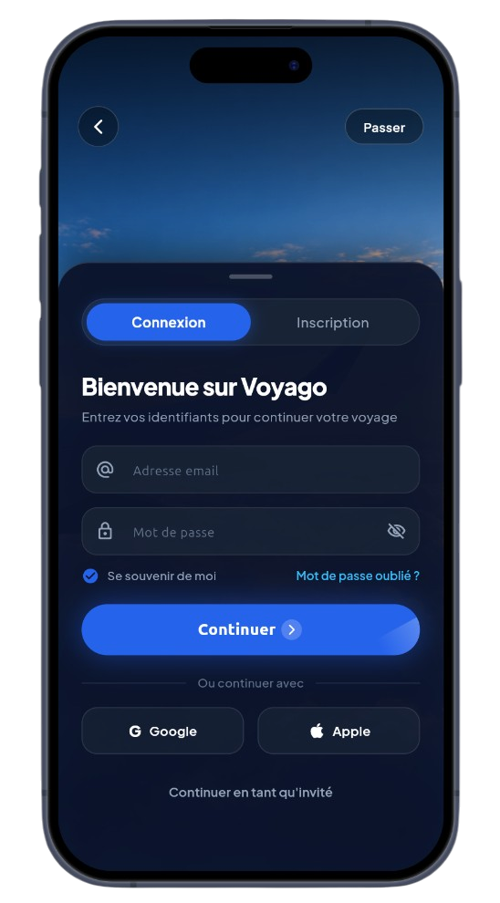
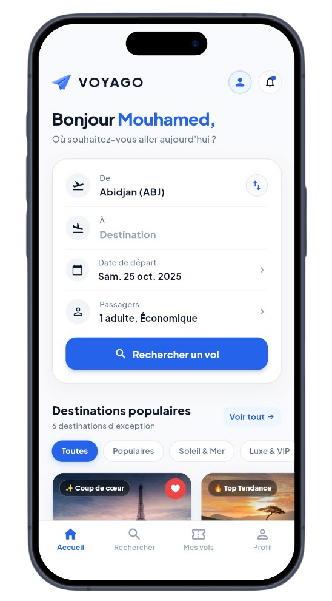
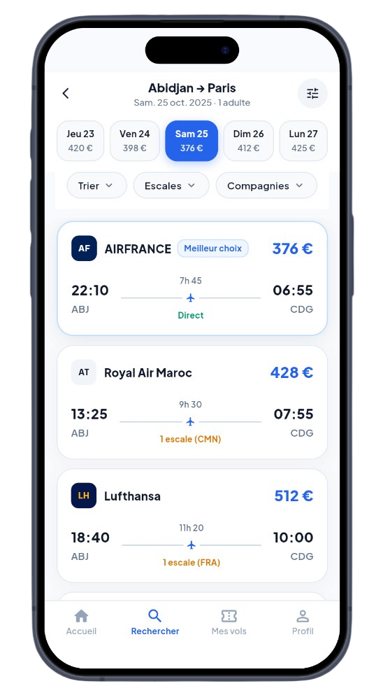

# Voyago — Premium Flight Booking & Travel Companion Mobile App

A **next-generation luxury travel and flight booking mobile application** crafted with Flutter and Dart, featuring seamless flight search choreography, curated worldwide destinations, interactive itinerary filtering, dynamic booking validation with signature morphing animations, and unified persistent navigation.

---

## Features

- **Cinematic Welcome & Onboarding** – High-impact introduction sequence highlighting the signature paper airplane branding, ambient aeronautical wing backdrop, and an instant-response CTA with real-time gyroscopic loading.
- **Frosted Authentication & Guest Exploration** – Translucent backdrop login modal with dual-mode authentication (Sign In & Sign Up), input validation with responsive shake feedback, and a seamless *Passer* (Skip) action for instant guest access.
- **Interactive Flight Search Hub** – Sleek departure and destination configuration card with one-touch city swapping, modal destination selection, date and passenger pickers, and direct flight discovery queries.
- **Curated Global Destinations Showcase** – Edge-to-edge scrollable gallery featuring world-class destinations (Paris, Dakar, Dubaï, New York, Tokyo, Marrakech) with high-definition photography, direct flight durations, live ratings, discount badges, and thematic category filters (*Top Tendance*, *Soleil & Mer*, *Luxe & VIP*, *Urbain*).
- **Interactive Favorites Wishlist** – One-tap heart bookmarking on destination cards with bouncing micro-animations and responsive floating status alerts.
- **Comprehensive Flight Ticket Explorer** – Real-time flight search results across premier airlines (Air France, Royal Air Maroc, Lufthansa, Emirates) with departure/arrival timelines, "Meilleur choix" badges, and interactive date timeline bars.
- **Multi-Criteria Smart Filter Engine** – Bottom-sheet filters for sorting (*Lowest Price*, *Shortest Duration*, *Earliest Departure*), stops (*Direct*, *1 Stop max*), and airline filtering with instant list updates.
- **Signature Morphing Booking Confirmation** – Complete flight overview (itinerary, schedule, baggage allowance, passenger) with a bespoke morphing action button that contracts into a spinning loader before drawing an animated green checkmark (V) upon confirmation.
- **Persistent Bottom Navigation** – Floating 4-tab bottom navigation bar (*Accueil*, *Rechercher*, *Mes réservations*, *Profil*) that remains permanently visible and accessible throughout the entire search and booking flow.
- **Personalized Profile & Loyalty Hub** – Dedicated user dashboard displaying account credentials, Gold Member status, accumulated Voyago frequent flyer miles, travel preferences, and instant account creation shortcuts for guest users.

---

## Technologies Used

- **Flutter SDK** – High-performance cross-platform framework delivering 60fps native rendering and responsive UI layouts.
- **Dart** – Strongly-typed language structuring clean feature-driven architecture and robust data models.
- **Google Fonts** – Premium modern typography pairing **Plus Jakarta Sans** and **Space Grotesk** for luxury editorial aesthetics.
- **Flutter Animate & Bespoke Physics** – Custom `AnimationController` choreographies, physics-based springs, and multi-phase morphing button transitions.
- **Singleton Architecture & State Management** – Centralized in-memory authentication and user session management (`AuthService`).
- **Device Preview** – Real-time multi-resolution device simulation ensuring pixel-perfect layout integrity.

---

## Preview

  
  

  
  

